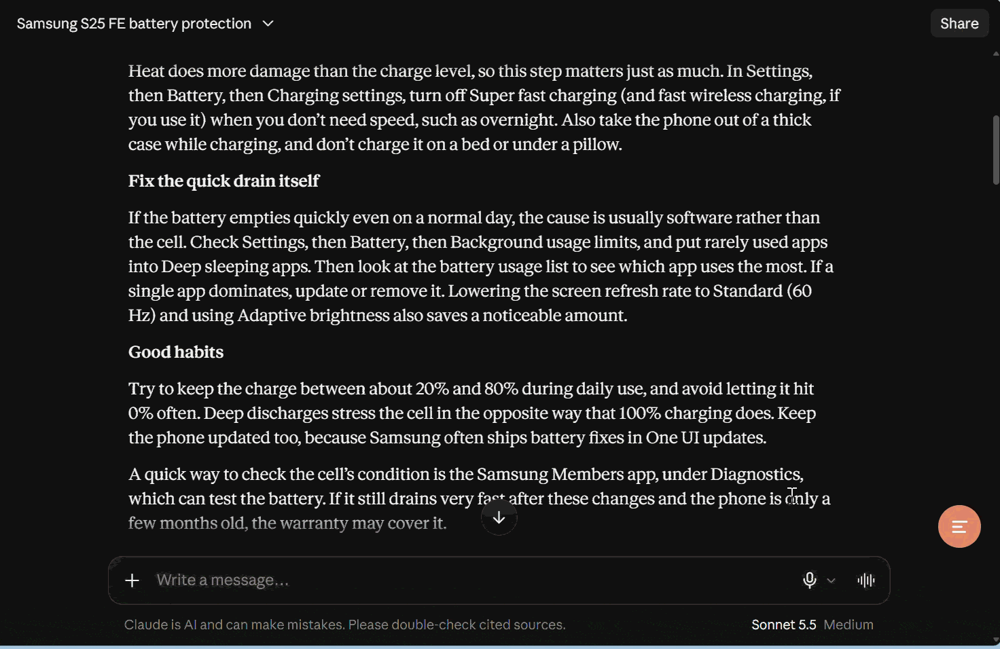

<div align="center">

# 🧭 Claude Navigator

**Jump to any message in even the longest [claude.ai](https://claude.ai) conversations.**

A fast, clean sidebar that outlines your whole chat, searches it, and scrolls straight to any message —
even when claude.ai has only a handful of messages loaded on the page.




</div>

> ⚠️ **Unofficial project.** Claude Navigator is an independent browser extension. It is not made, endorsed, or
> supported by Anthropic. "Claude" and "claude.ai" are trademarks of their respective owners.

---

## 📑 Table of contents
- [✨ Features](#-features)
- [🤔 Why this exists](#-why-this-exists)
- [🚀 Installation](#-installation)
- [🎮 Usage](#-usage)
- [⌨️ Keyboard shortcuts](#️-keyboard-shortcuts)
- [⚙️ Settings](#️-settings)
- [🏗️ How it works](#️-how-it-works)
- [📁 Project structure](#-project-structure)
- [🧪 Development & testing](#-development--testing)
- [🛠️ Troubleshooting](#️-troubleshooting)
- [🔒 Privacy & security](#-privacy--security)
- [⚠️ Known limitations](#️-known-limitations)
- [🗺️ Roadmap](#️-roadmap)
- [🤝 Contributing](#-contributing)
- [📄 License](#-license)

---

## ✨ Features

| | Feature | Details |
|---|---|---|
| 🗂️ | **Complete outline** | Lists *every* message in the conversation, not only the few claude.ai has rendered |
| 🎯 | **Reliable jump** | Click any row to scroll to that message and highlight it, even if it isn't on the page yet |
| ⚡ | **Adjustable speed** | Scroll speed from 1 (slow, smooth) to 10 (instant); default 5; remembered between sessions |
| 🔍 | **Instant search** | Full-text search across the whole chat with match highlighting |
| 🧑‍🤝‍🤖 | **Filters** | Show everything, only your prompts, or only Claude's replies |
| 👁️ | **Message reader** | Tap the eye to read a full message in a panel; tap again to close |
| 📍 | **Position tracking** | The outline highlights the message you are currently reading |
| 📤 | **Export** | Save the conversation as Markdown or JSON, or save a single message |
| 🌗 | **Light & dark** | Follows claude.ai's theme with a clean, minimal design |
| 🖱️ | **Stay in control** | Scrolling the chat yourself cancels a jump in progress; a pin keeps the sidebar open |
| 🪶 | **Lightweight** | Virtualized list: 5,000 messages filter and render in under 150 ms (tested) |
| 🔐 | **Private** | No external servers, no tracking, no dependencies |

---

## 🤔 Why this exists

claude.ai renders long conversations through a **virtualized transcript**: one very tall scroll area that keeps only
a few messages on the page at a time. Older (and newer) messages literally aren't there, so:

- ❌ scraping the page can't list the whole conversation
- ❌ "scroll to message" can't work on a message that isn't rendered

**Claude Navigator separates the two problems:**

| Question | Answer comes from |
|---|---|
| 📚 *Which messages exist?* | claude.ai's own conversation data, loaded once per chat |
| 📍 *Where is a message on screen?* | The rows currently rendered, matched to that data |

Jumping then becomes a short **estimate → render → correct** loop (typically 2–6 quick steps) until the message
appears.

---

## 🚀 Installation

> Not yet on the Chrome Web Store — install it in developer mode (takes 30 seconds).

1. 📥 **Download** this repository (`Code → Download ZIP`) and unzip it, or `git clone` it.
2. 🌐 Open **`chrome://extensions`** (works in Chrome, Edge, Brave, and other Chromium browsers).
3. 🔧 Turn on **Developer mode** (top right).
4. 📂 Click **Load unpacked** and select the folder that contains `manifest.json`.
5. 🔄 Open or hard-reload **claude.ai** (`Ctrl+Shift+R`).

<details>
<summary>🔁 <b>Updating to a new version</b></summary>

Remove the old copy from `chrome://extensions`, load the new folder, then hard-reload claude.ai.
Settings (speed, pin) are kept by Chrome.
</details>

---

## 🎮 Usage

Open any conversation on claude.ai. The sidebar appears on the right. If you close it, bring it back with the round
button or the keyboard shortcut.

| I want to… | Do this |
|---|---|
| 🧭 Jump to a message | **Click its row** |
| 👁️ Read a message in full | Click the **eye**; click it again to hide |
| 🔍 Search | Press **`/`**, type, then **`↑ ↓`** and **`Enter`** |
| ⏭️ First / latest message | Arrow buttons next to the filter |
| ⚙️ Speed, export, reload, diagnostics | **Gear** icon |
| 📌 Keep the sidebar open while chatting | **Pin** icon |
| 💾 Save one message | **Save** icon on its row |

**Status badge** under the search box:
- 🟢 **Full history** — the whole conversation is loaded.
- 🟠 **Page only** — claude.ai's data couldn't be read; only messages currently on the page are listed
  (see [Troubleshooting](#️-troubleshooting)).

---

## ⌨️ Keyboard shortcuts

| Shortcut | Action |
|---|---|
| `Alt` + `Shift` + `N` | Show / hide the sidebar |
| `/` | Focus search |
| `↑` `↓` then `Enter` | Move through messages and jump |
| `Alt` + `↑` / `↓` | Previous / next message |
| `Esc` | Clear search, close settings, close reader, then close sidebar |

> 💡 Change the toggle shortcut at `chrome://extensions/shortcuts`. (Chrome reserves the incognito-window combination,
> so that one can't be used by extensions.)

---

## ⚙️ Settings

Open the **gear** icon in the sidebar header.

| Setting | Description |
|---|---|
| 🎚️ **Scroll speed** | `1` slow & smooth → `10` instant. Default **5**. Controls both how fast the extension hunts for an unrendered message and the length of the final glide |
| 📤 **Export** | Markdown (original formatting, code blocks intact) or JSON |
| 🔄 **Reload** | Re-sync the conversation from claude.ai |
| 🩺 **Diagnostics** | Copies a structure-only report (no message text) for bug reports |

---

## 🏗️ How it works

```
 claude.ai conversation data ──► items[]  (complete history: id, role, text…)
                                    ▲
 rendered rows ──► bind() ──────────┘   align on-screen rows ↔ data
                                    │
 click a row ──► jumpTo(): estimate scroll → page renders → bind() → glide → highlight
```

**Highlights**
- 🌿 **Current branch only** — follows the active path through edited/retried messages.
- 🧩 **Position-based matching** — rows vote on an alignment offset, so repeated prompts ("continue") and look-alike
  replies resolve to the right message.
- 🛡️ **Never guesses** — if two messages can't be told apart, it does nothing rather than land on the wrong one.
- 🪟 **Virtualized outline** — only ~30 rows exist in the DOM, however long the chat is.
- 🔁 **Graceful fallback** — if the data endpoint is unavailable, it scans the page; if claude.ai renames its markup,
  a text-based lookup still finds messages.

📖 Full details: [`docs/ARCHITECTURE.md`](docs/ARCHITECTURE.md)

---

## 📁 Project structure

```
claude-navigator/
├── manifest.json        # Manifest V3 · claude.ai only
├── content.js           # All logic: data loading, outline, jump, reader, export
├── sidebar.css          # Sidebar / reader / toast styles (light + dark)
├── background.js        # Service worker: keyboard command → toggle sidebar
├── popup/               # Toolbar popup (help + recent conversations)
├── icons/               # Extension icons
├── tests/               # Zero-dependency automated tests
│   ├── fake-dom.js      #   browser simulation
│   ├── harness.js       #   loads the real content.js
│   └── run.js           #   the test suite
├── docs/
│   ├── ARCHITECTURE.md  #   how it works & what it depends on
│   ├── TROUBLESHOOTING.md  # symptoms → fixes, bug-report template
│   └── TESTING.md       #   running & extending the tests
└── CHANGELOG.md
```

---

## 🧪 Development & testing

No build step, no dependencies. Requires Node 18+ for the tests only.

```bash
node tests/run.js              # run everything (~30 s)
node tests/run.js jump         # only tests whose name contains "jump"
```

The suite (**67 tests**) runs the real `content.js` against a simulated browser, including a virtualized chat like
claude.ai's. It covers:

- ✅ manifest & packaging checks · ✅ undefined-name static analysis
- ✅ conversation loading, branches, API outage fallback
- ✅ jumping on virtualized transcripts at every speed · ✅ look-alike messages · ✅ changed page markup
- ✅ outline performance with 5,000 messages · ✅ search / filters / XSS escaping
- ✅ eye toggle · ✅ settings persistence · ✅ export · ✅ diagnostics privacy

> 🔬 It's a simulation. Before a release, also run the manual checklist in
> [`docs/TESTING.md`](docs/TESTING.md) on a real long chat.

**Every bug gets a regression test** — see the post-mortem table in
[`docs/TROUBLESHOOTING.md`](docs/TROUBLESHOOTING.md).

---

## 🛠️ Troubleshooting

Start by clicking **⚙️ → Diagnostics** and reading the report with
[`docs/TROUBLESHOOTING.md`](docs/TROUBLESHOOTING.md).

| Symptom | Quick fix |
|---|---|
| Sidebar missing | Check the extension is enabled, hard-reload claude.ai, try `Alt+Shift+N` |
| Badge says 🟠 *Page only* | ⚙️ → **Reload**. If it persists, claude.ai's data format may have changed — see the doc |
| Jump does nothing | Run **Diagnostics**; check `scroller` and `boundToPage` |
| Jump is slow | Raise **Scroll speed** (10 = instant) |
| Shortcut doesn't work | Set your own at `chrome://extensions/shortcuts` |

<details>
<summary>🐞 <b>Reporting a bug</b></summary>

Please include:
1. Extension version and browser/OS
2. Approximate chat length and exact steps
3. The **Diagnostics** JSON (it contains no message text)
4. Any `[Claude Navigator]` errors from the DevTools console

A ready-made template is in [`docs/TROUBLESHOOTING.md`](docs/TROUBLESHOOTING.md#4-bug-report-template-paste-into-an-issue-or-to-claude).
</details>

---

## 🔒 Privacy & security

- 🏠 Runs **only** on `https://claude.ai/*`.
- 🔐 Reads your conversation from claude.ai **using your own logged-in session**, and keeps it **in memory only**.
- 🚫 Contacts **no other server**; no analytics, no telemetry, no remote code.
- 💾 Stores only settings and a short list of recent chat titles/URLs in `chrome.storage.local`.
- 🩺 The Diagnostics report contains page structure only — never message text — and redacts the chat ID.
- 🧼 All message text is escaped before it reaches the page UI.

---

## ⚠️ Known limitations

- 🔧 Depends on claude.ai internals (the conversation data endpoint, `data-testid` markers, a single scroll
  container). These can change without notice — see the dependency table in
  [`docs/ARCHITECTURE.md`](docs/ARCHITECTURE.md#7-what-we-depend-on-in-claudeai-the-fragile-parts).
- 🌿 Only the **current branch** of an edited/retried conversation is shown.
- 🔧 Messages that contain only tool activity (no text) aren't listed.
- 📏 Verified live on a ~95-message chat; 1,000–5,000 messages were verified in simulation.

---

## 🗺️ Roadmap

- [ ] 📸 Screenshots / demo GIF
- [ ] 🔖 Bookmarks / pinned messages
- [ ] 📑 Export a selected range
- [ ] 🧵 Branch switcher for edited conversations
- [ ] 🦊 Firefox support
- [ ] 🏪 Chrome Web Store release

Have an idea? Open an issue! 💡

---

## 🤝 Contributing

Contributions are welcome! 🎉

1. 🍴 Fork the repo and create a branch (`git checkout -b fix/my-bug`)
2. 📖 Read [`docs/ARCHITECTURE.md`](docs/ARCHITECTURE.md) — especially the **invariants** section
3. 🧪 Reproduce the problem in the test harness, fix it, and **add a regression test**
4. ✅ Run `node tests/run.js` — everything must pass
5. 📝 Update [`CHANGELOG.md`](CHANGELOG.md) and open a pull request

**Selectors changed on claude.ai?** That's the most common breakage. Update `CFG.SEL` in `content.js`, then use the
`selectorless` test option to confirm the fallback still works.

---

## 📄 License

Released under the **MIT License** — see [`LICENSE`](LICENSE).

---

<div align="center">

Made with ❤️ for people who have *very* long conversations with Claude.

⭐ If this saved you from endless scrolling, consider starring the repo!

</div>
